<!-- HEADER ANIMATION -->

<h1 align="center">👋 Hi, I'm Zuko</h1>
<h3 align="center">Software Developer | DevSecOps Engineer in Progress | Cloud & Cybersecurity Enthusiast</h3>

<!-- TYPING ANIMATION -->

  

 

## 🚀 About Me

I'm a full-stack software developer working towards a career in DevSecOps, where development, cloud infrastructure, automation, and cybersecurity come together. I like building practical, reliable software, along with the cloud and security tooling that keeps it safe in production.

I'm currently sharpening my skills through **WeThinkCode_**, with a focus on strong engineering fundamentals, clean code, and object-oriented design. Alongside my coursework I build projects that put those skills to work, from a passive web security scanner to serverless AWS tooling deployed with Terraform.

My goal is to become a DevSecOps Engineer who can build, deploy, and maintain secure systems end to end. I'm especially drawn to the AWS ecosystem, and I keep exploring new cloud technologies and security practices as I go.

---

## 🎯 Current Focus

- 🔐 **Cybersecurity & Secure Application Development**
- ☁️ **Cloud Computing (AWS & Oracle Cloud)**
- 🔄 **CI/CD & DevSecOps (GitHub Actions, CodeQL, Trivy)**
- 🏗️ **Infrastructure as Code (Terraform)**
- 🖥️ **Full-Stack Development (Java, Python, React, TypeScript & Next.js)**
- ⚙️ **Backend Development & REST APIs**
- 🗄️ **Database Design (PostgreSQL & MySQL)**
- 🐳 **Docker & System Deployment**

---

## 🛠️ Tech Stack

  <b>Languages</b> 
  

  <b>Backend & Data</b> 
  

  <b>Frontend</b> 
  

  <b>Cloud & DevOps</b> 
  

  <b>Also:</b> Spring Security, JPA/Hibernate, Flyway, JWT, OpenAPI/Swagger, JUnit, pytest 
  <b>Security tooling:</b> CodeQL, Trivy, Bandit, pip-audit 
  <b>AWS services:</b> Lambda, API Gateway, DynamoDB, CloudWatch, IAM

---

## 📂 Current Projects & Learning Journey

### ☕ Java Development
- Object-oriented programming projects
- Design patterns and clean architecture practice
- Console applications and backend systems
- Spring Boot, Spring Security and JPA in [sentinel-secscan](https://github.com/ZukoG/sentinel-secscan)

### ⚙️ Backend Engineering
- REST APIs
- Database integration
- Server-side application development
- JWT authentication, PostgreSQL and Flyway migrations
- MySQL database design in a team brownfield project at WeThinkCode_

### 🖥️ Full-Stack Development
- React and TypeScript frontends, Node and Express backends, see [Mini-music-app](https://github.com/ZukoG/Mini-music-app)
- Next.js in a collaborative team project
- Python backend with a JavaScript web frontend in [zuri-watch-guard](https://github.com/ZukoG/zuri-watch-guard)

### ☁️ Cloud Computing
- AWS fundamentals
- Oracle Cloud Infrastructure
- Cloud deployment concepts
- Serverless on AWS (Lambda, API Gateway, DynamoDB) deployed with Terraform in [sentinel-cloudcheck](https://github.com/ZukoG/sentinel-cloudcheck)

### 🔐 Cybersecurity
- Security-focused projects
- Exploring vulnerability awareness
- Building safer software systems
- Passive web security scanning in [sentinel-secscan](https://github.com/ZukoG/sentinel-secscan)
- Leaked secret detection in git history with [sentinel-secrets](https://github.com/ZukoG/sentinel-secrets)

---

## 🔥 Current Mission

Building projects that combine:

**Full-Stack Software Engineering + Cloud Infrastructure + Cybersecurity + DevSecOps**

Every repository represents another step towards becoming a better engineer.

> "Every commit is another step toward becoming a better engineer."

---

## 📊 GitHub Stats

<!-- fixed: github-readme-stats.vercel.app's public deployment is now permanently paused (project is unmaintained,
     see anuraghazra/github-readme-stats#4867), so the stats/top-langs cards below now come from the new
     stats.yml Action (same pattern as snake.yml) which renders them to static SVGs committed under profile/.
     streak-stats.demolab.com is a separate service and was still working fine, left as-is. -->

  
  

  

---

## 🐍 Contribution Snake

  <!-- fixed: snake.yml pushes dist/*.svg to the ROOT of the output branch (crazy-max/ghaction-github-pages strips the dist/ prefix), so the old "output/dist/..." path 404'd -->
  

---

## 📚 Currently Learning

- 🌱 Cloud Architecture (AWS)
- 🌱 Secure Software Development & Application Security
- 🌱 DevSecOps Practices (CI/CD pipelines, SAST and dependency scanning)
- 🌱 Kubernetes & Container Orchestration
- 🌱 System Design Fundamentals
- 🌱 Full-Stack Development (Java, Python, React & Next.js)

---

## 🤝 Connect With Me

  
  

 

🚀 Always learning. Always building.

<!-- FOOTER -->

